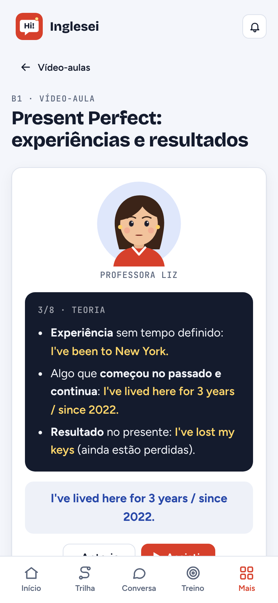
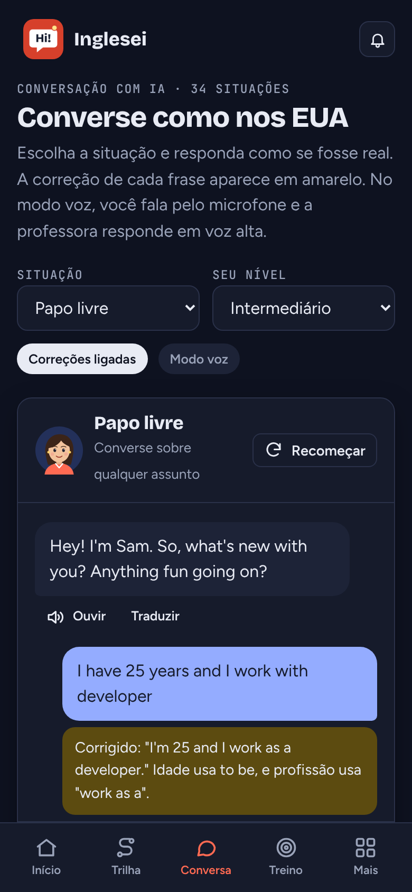
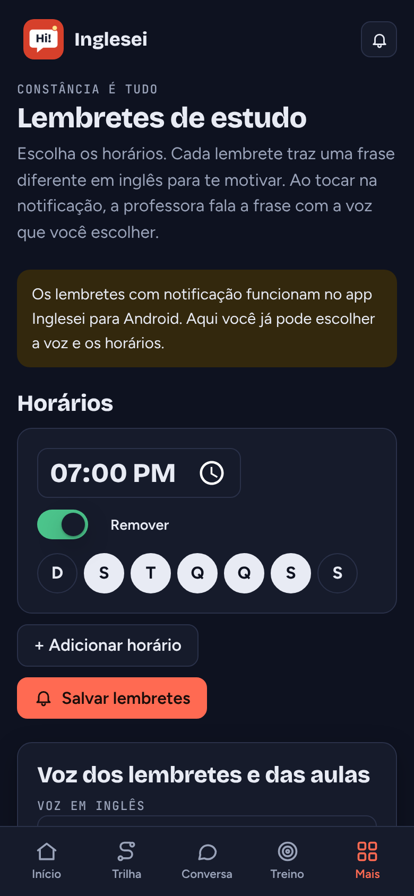

# Inglesei 🇺🇸💬

**Aplicativo para aprender inglês americano**, com teoria do A1 ao C1, vídeo-aulas narradas por uma professora animada, gírias reais, conversa com IA que corrige cada frase e lembretes diários com frases motivacionais em inglês.

Feito com **HTML, CSS e JavaScript puro**, empacotado como **app Android** com [Capacitor](https://capacitorjs.com/).

<p align="center">
  
  
  
  
</p>

## 📲 Instalar no Android

1. No celular, abra a página **[Releases](../../releases/latest)** deste repositório.
2. Baixe o arquivo **Inglesei.apk** e toque nele.
3. Se o Android pedir, permita **"Instalar apps desconhecidos"** para o navegador.
4. Abra o Inglesei. As versões novas instalam por cima e mantêm o seu progresso.

> O APK é gerado automaticamente pelo GitHub Actions a cada atualização do código.

## ✨ O que o app tem

| Recurso | Detalhes |
|---|---|
| 📚 **Trilha A1 → C1** | 38 lições com teoria, exemplos com áudio, erros comuns de brasileiros e 134 exercícios |
| 🎬 **Vídeo-aulas** | A professora **Liz** (avatar animado) explica cada lição com voz e legenda, em português e inglês |
| ✨ **Aula sob medida** | A IA cria uma aula narrada + quiz sobre qualquer tema ("pedir comida no drive-thru") |
| 💬 **Conversa com IA** | 34 situações reais (imigração, entrevista de dev, daily, Thanksgiving, farmácia...), correção em amarelo, dicas de resposta, tradução |
| 🎙️ **Modo voz** | Você fala pelo microfone e a professora responde em voz alta |
| 🗣️ **Gírias e expressões** | 145 gírias com o registro de cada uma (neutra, informal, Gen Z, vulgar), 50 phrasal verbs e 42 idioms |
| 🎯 **Treino** | Flashcards com repetição espaçada, treino de ouvido, treino de fala, redação corrigida e quiz |
| ⏰ **Lembretes** | Notificações nos dias e horários que você escolher, com 30 frases motivacionais em inglês e voz configurável |
| 📈 **Progresso** | XP, níveis, meta diária, dias seguidos e backup |
| 🌙 **Tema escuro** | Segue o tema do celular |

## 🤖 IA: Claude ou Gemini

A IA é **sua**: você cola uma chave de API em **Ajustes**, e ela fica salva **só no seu aparelho**.

- **Claude (Anthropic):** melhor qualidade. É pago por uso: uma conversa de prática custa centavos. Crie a chave em `console.anthropic.com`. O app usa o **SDK oficial** (`@anthropic-ai/sdk`), com o Claude Opus 5.5 ou o Claude Haiku 5.5 (mais econômico).
- **Gemini (Google):** tem **faixa gratuita**. Crie a chave em `aistudio.google.com`.

Sem chave, a trilha, as vídeo-aulas, as gírias e o treino funcionam normalmente, inclusive **sem internet**.

## 🛠️ Tecnologias

- **HTML, CSS e JavaScript** (sem frameworks), organizados em módulos ES e empacotados com **esbuild**
- **Capacitor 8** para gerar o app Android, com plugins nativos de **voz** (text-to-speech), **reconhecimento de fala** e **notificações locais**
- **@anthropic-ai/sdk** (Claude) com streaming das respostas, e a API REST do **Gemini**
- **Playwright** para testes ponta a ponta, com as APIs de IA simuladas
- **GitHub Actions** para rodar os testes e publicar o APK a cada push
- Versão web instalável (**PWA**) com service worker para funcionar offline

## 📁 Estrutura

```
inglesei/
├── src/
│   ├── main.js          # Telas e navegação do app
│   ├── ai.js            # Integração com Claude (SDK) e Gemini
│   ├── platform.js      # Voz, microfone e lembretes (nativo ou web)
│   ├── tutor.js         # Professora Liz: avatar animado e player de aulas
│   └── content/         # Lições, gírias, cenários e frases motivacionais
├── www/                 # index.html, estilos, fontes e ícones
├── android/             # Projeto Android gerado pelo Capacitor
├── tests/app.test.js    # 12 testes E2E
└── .github/workflows/   # Testes + APK (android.yml) e versão web (pages.yml)
```

## 💻 Rodar no computador

```bash
npm install
npm run build
npx serve www
```

Testes:

```bash
npx playwright install chromium
npm test
```

## 🔒 Privacidade

- A chave de API e o progresso ficam salvos **só no aparelho**.
- O app envia para a IA apenas o que você escreve na conversa e nos exercícios.
- Nenhuma chave fica no código deste repositório.

## 👤 Autor

**Moacir de Jesus Nascimento** · [LinkedIn](https://www.linkedin.com/in/moacir-nascimento2003/) · [GitHub](https://github.com/moacirnascimento439) · [Portfólio](https://moacirnascimento439.github.io/)

## 📄 Licença

MIT
