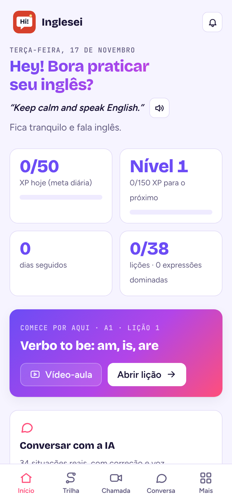
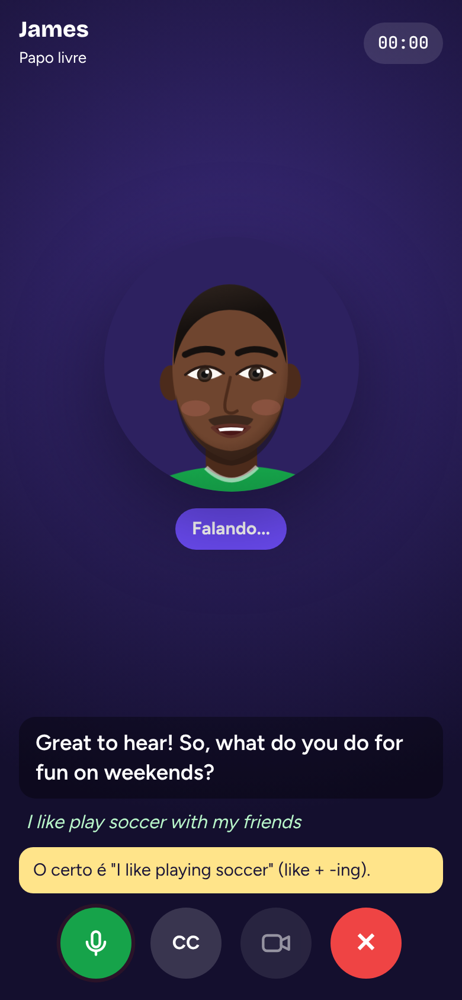
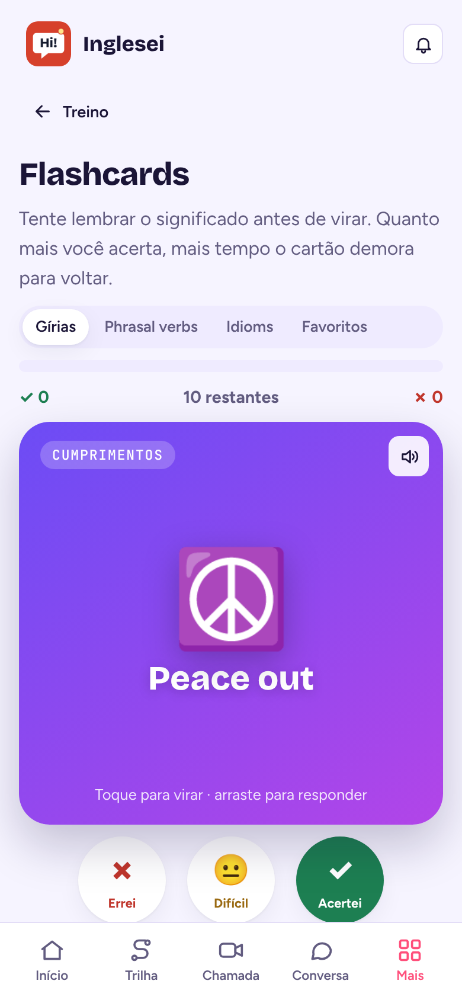

# Inglesei 🇺🇸💬

**Aplicativo para aprender inglês americano**, com teoria do A1 ao C1, chamada de vídeo com professores animados, vozes naturais de homem e de mulher, gírias reais, conversa com IA que corrige cada frase e lembretes que falam em inglês.

Feito com **HTML, CSS e JavaScript puro**, empacotado como **app Android** com [Capacitor](https://capacitorjs.com/).

<p align="center">
  
  
  
  
</p>

## 📲 Instalar no Android

1. No celular, abra a página **[Releases](../../releases/latest)** deste repositório.
2. Baixe o arquivo **Inglesei.apk** e toque nele.
3. Se o Android pedir, permita **"Instalar apps desconhecidos"** para o navegador.
4. Abra o Inglesei. As versões novas instalam por cima e mantêm o seu progresso.

> O APK é gerado automaticamente pelo GitHub Actions a cada atualização do código.

## ✨ O que o app tem

| Recurso | Detalhes |
|---|---|
| 📚 **Trilha A1 → C1** | 38 lições com teoria, exemplos com áudio, erros comuns de brasileiros e 134 exercícios |
| 📞 **Chamada de vídeo com IA** | Fale em voz alta com o professor: ele responde falando, o app escuta você automaticamente, e aparecem legenda, tradução e correções. Sua câmera é opcional |
| 👩‍🏫 **6 professores** | Liz, Sofia, Aisha, Mike, James e Carlos, com rosto animado (pisca, fala, balança a cabeça) e voz combinando. Também dá para usar uma foto |
| 🔊 **Vozes naturais** | 4 vozes embutidas (Emma, Amy, Ryan e Joe) geradas com o Piper, que funcionam **offline e grátis**, e 16 vozes com IA (Gemini e OpenAI) para as respostas da conversa |
| 🎬 **Vídeo-aulas** | O professor escolhido explica cada lição com voz e legenda, em português e inglês |
| ✨ **Aula sob medida** | A IA cria uma aula narrada + quiz sobre qualquer tema ("pedir comida no drive-thru") |
| 💬 **Conversa com IA** | 34 situações reais (imigração, entrevista de dev, daily, Thanksgiving, farmácia...), correção em amarelo, dicas de resposta, tradução |
| 🗣️ **Gírias e expressões** | 145 gírias com o registro de cada uma (neutra, informal, Gen Z, vulgar), 50 phrasal verbs e 42 idioms, todas ilustradas |
| 🃏 **Flashcards interativos** | Cartões coloridos com ilustração, que viram em 3D e se respondem arrastando para os lados, com repetição espaçada |
| 🎯 **Treino** | Treino de ouvido, treino de fala, redação corrigida e quiz |
| ⏰ **Lembretes que falam** | Na hora marcada, uma voz natural diz em inglês que é hora de estudar. Passo a passo de permissões e lista dos próximos lembretes |
| 🎨 **5 temas de cores** | Vibrante, Oceano, Pôr do sol, Floresta e Clássico, cada um com modo claro e escuro |
| 📈 **Progresso** | XP, níveis, meta diária, dias seguidos e backup |

## 🤖 IA: Claude ou Gemini

A IA é **sua**: você cola uma chave de API em **Ajustes**, e ela fica salva **só no seu aparelho**.

- **Claude (Anthropic):** melhor qualidade. É pago por uso: uma conversa de prática custa centavos. Crie a chave em `console.anthropic.com`. O app usa o **SDK oficial** (`@anthropic-ai/sdk`), com o Claude Opus 5.5 ou o Claude Haiku 5.5 (mais econômico).
- **Gemini (Google):** tem **faixa gratuita**. Crie a chave em `aistudio.google.com`.

Sem chave, a trilha, as vídeo-aulas, as gírias, os flashcards e o treino funcionam normalmente, inclusive **sem internet**.

### Vozes
- **Vozes embutidas (grátis, offline):** todas as frases fixas do app (exemplos, gírias, expressões e lembretes) já vêm gravadas com voz natural em 4 vozes. O áudio é gerado no build com o [Piper](https://github.com/OHF-voice/piper1-gpl), um motor de voz neural de código aberto.
- **Vozes com IA:** para o que muda a cada vez (respostas da conversa, chamada e aulas sob medida), o app usa o **Gemini** (mesma chave, faixa gratuita com limite diário) ou a **OpenAI** (paga por uso). O Claude não gera áudio. Os áudios ficam guardados no celular para não gastar de novo.

## 🛠️ Tecnologias

- **HTML, CSS e JavaScript** (sem frameworks), organizados em módulos ES e empacotados com **esbuild**
- **Capacitor 8** para gerar o app Android, com plugins nativos de **voz** (text-to-speech), **reconhecimento de fala** e **notificações locais** com som personalizado
- **@anthropic-ai/sdk** (Claude) com streaming das respostas, e a API REST do **Gemini**
- **Piper** (Python) no GitHub Actions para gerar as vozes naturais, com **ffmpeg** convertendo para Opus
- **Avatares em SVG** desenhados em código, com animações em CSS (piscar, falar, balançar a cabeça)
- **IndexedDB** para guardar os áudios gerados por IA
- **Playwright** para testes ponta a ponta, com as APIs de IA e o microfone simulados
- **GitHub Actions** para rodar os testes e publicar o APK a cada push
- Versão web instalável (**PWA**) com service worker para funcionar offline

## 📁 Estrutura

```
inglesei/
├── src/
│   ├── main.js          # Telas e navegação do app
│   ├── ai.js            # Claude (SDK) e Gemini para texto; Gemini e OpenAI para voz
│   ├── voice.js         # Motor de voz: vozes embutidas, voz com IA e voz do celular
│   ├── avatars.js       # Os 6 professores em SVG
│   ├── platform.js      # Microfone, câmera e lembretes (nativo ou web)
│   ├── tutor.js         # Player das vídeo-aulas
│   └── content/         # Lições, gírias, ilustrações, cenários e frases
├── tools/               # Geração das vozes (Piper) e dos ícones
├── www/                 # index.html, estilos, fontes e ícones
├── android/             # Projeto Android gerado pelo Capacitor
├── tests/app.test.js    # 19 testes E2E
└── .github/workflows/   # Testes + vozes + APK (android.yml) e versão web (pages.yml)
```

## 💻 Rodar no computador

```bash
npm install
npm run build
npx serve www
```

Testes:

```bash
npx playwright install chromium
npm test
```

## 🔒 Privacidade

- A chave de API e o progresso ficam salvos **só no aparelho**.
- O app envia para a IA apenas o que você escreve na conversa e nos exercícios.
- Nenhuma chave fica no código deste repositório.

## 👤 Autor

**Moacir de Jesus Nascimento** · [LinkedIn](https://www.linkedin.com/in/moacir-nascimento2003/) · [GitHub](https://github.com/moacirnascimento439) · [Portfólio](https://moacirnascimento439.github.io/)

## 📄 Licença

MIT
